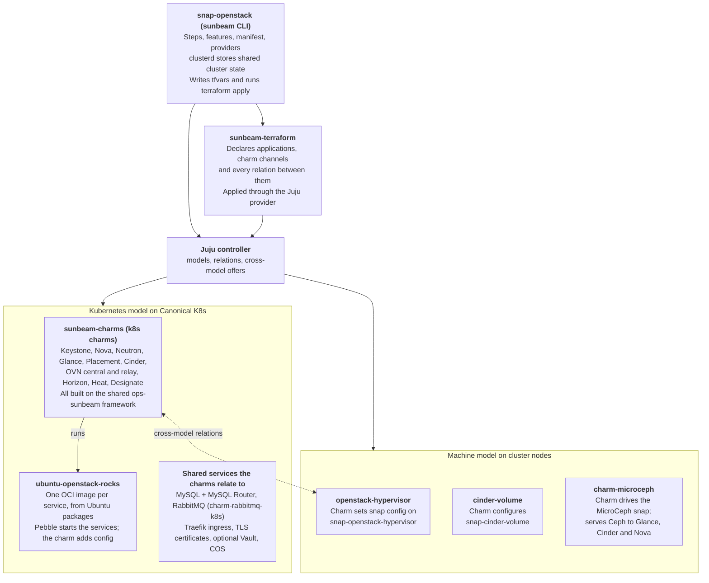

# Canonical OpenStack repo exploration plan

Oct 22, 2026

## Big picture: how the repos fit together

The `sunbeam` CLI (snap-openstack) decides what to deploy, sunbeam-terraform declares it, and Juju runs it in two places: control-plane services as k8s charms running rocks, and node-local services as machine charms configuring snaps. Explore in that same order, top to bottom.



The dotted arrow is the cross-model relations (AMQP, database, identity, OVN, Ceph) that tie the node-side snaps back to the control plane. Not drawn: the sunbeam-machine and Canonical K8s machine charms, which prepare each node and form the K8s cluster itself.

## Order at a glance

Start at the user's entry point (the `sunbeam` CLI) and work outward: what it deploys, how each charm is built, what runs inside, then the dependencies you integrate with but don't own. Phases 1–6 are the core repos you will maintain; phases 7–8 are read for their interfaces only.

| Phase | Repo | Kind | Why at this point | Depth |
| --- | --- | --- | --- | --- |
| 1 | [snap-openstack](https://github.com/canonical/snap-openstack) | Snap + Python CLI + Go clusterd | Entry point; orchestrates everything else | Deep, 2–3 sessions |
| 2 | [sunbeam-terraform](https://github.com/canonical/sunbeam-terraform) | Terraform plans | The "what gets deployed and wired" contract between CLI and charms | Medium |
| 3 | [sunbeam-charms](https://opendev.org/openstack/sunbeam-charms) | Monorepo of charms + ops-sunbeam | Where most day-to-day maintenance lands | Deep, 3–4 sessions |
| 4 | [ubuntu-openstack-rocks](https://github.com/canonical/ubuntu-openstack-rocks) | Rocks (OCI images) | The workload containers the k8s charms drive via Pebble | Medium |
| 5a | [snap-openstack-hypervisor](https://github.com/canonical/snap-openstack-hypervisor) | Snap | The compute node data plane, configured by a charm | Medium |
| 5b | [snap-cinder-volume](https://github.com/canonical/snap-cinder-volume) | Snap | Block storage volume service on storage nodes | Light–medium |
| 6a | [charm-microceph](https://github.com/canonical/charm-microceph) | Machine charm | Storage backend wiring into Glance/Cinder/RGW | Medium |
| 6b | [charm-rabbitmq-k8s](https://github.com/openstack-charmers/charm-rabbitmq-k8s) | K8s charm | Message bus for every OpenStack service | Light |
| 7 | MySQL, Traefik, TLS, Canonical K8s, MicroCeph, Juju | Dependencies | Read the relation interfaces/libs you consume | Interfaces only |
| 8 | Vault, COS stack, BIND 9 rock | Extended deps | Only when you work on the related feature | On demand |

Repo links are from the [Projects and charms](https://canonical.com/openstack/docs/2024.1/reference/underlying-projects-and-charms/) reference page (2024.1 docs).

## Phase 1: snap-openstack (the orchestrator)

This is the `openstack` snap you installed: it ships the `sunbeam` CLI and is the brain that turns a few commands into a running cloud. Everything else in this plan is something it deploys, configures or talks to.

**Responsibilities to understand**

- The `sunbeam` CLI (Python): command groups such as `prepare-node-script`, `cluster bootstrap`, `cluster join`/`add`, `configure`, `enable`/`disable`, `refresh`/upgrade.
- The step framework: how a command is decomposed into ordered, idempotent steps (`is_skip` / `run` style), and how failures and resumes are handled.
- Cluster state: the clusterd daemon (Go, built on microcluster) that stores nodes, roles, config and manifests across machines. Find where it lives in the repo and the API the Python side calls.
- Juju handling: bootstrapping or registering a controller, models (machine model vs k8s model), and the helper layer the CLI uses to wait for application/unit status.
- Terraform handling: how plans are vendored or fetched, how tfvars are generated from the manifest and stored in clusterd, and how `terraform apply` is invoked with the Juju provider.
- Manifests: the deployment manifest schema, defaults, and how user overrides flow into charm channels/revisions and config.
- Features (formerly plugins): how an optional feature (DNS, LBaaS, observability, Vault, TLS…) registers commands, adds terraform vars, and declares dependencies on other features.
- Providers: local/manual bare-metal vs MAAS provider, and how node roles (control, compute, storage) change what gets deployed.
- Snap packaging: `snapcraft.yaml`, bundled binaries (juju, terraform, openstack client), hooks, and channel/track naming per OpenStack release.

**Questions to put to Claude Code**

1. Trace `sunbeam cluster bootstrap` from the click entry point to the last step, listing each step class and what it changes.
2. Where is the manifest parsed, merged with defaults, and turned into terraform variables?
3. What does clusterd store, and which Python calls read and write it?
4. Walk through enabling one feature end to end (pick `dns` or `loadbalancer`).
5. How do `cluster join` and `cluster add` differ, and how is a join token produced and consumed?

**How it connects**: it deploys Canonical K8s and MicroCeph (via their charms), the sunbeam-machine and openstack-hypervisor machine charms, then applies sunbeam-terraform plans that deploy the sunbeam-charms k8s charms. Because it's the hub, plan two or three sessions here and come back after Phase 3.

## Phase 2: sunbeam-terraform (the deployment contract)

This repo declares which Juju applications make up the control plane, which charm channels they come from, and every integration (relation) between them. Read it right after snap-openstack because it is the clearest map of the whole cloud in one place.

**Responsibilities to understand**

- The Juju Terraform provider resources used (`juju_application`, `juju_integration`, `juju_offer`, models).
- Module layout: per-service modules (e.g. a reusable "OpenStack API service" module bundling the charm with its MySQL router and Traefik/RabbitMQ relations) vs the top-level plan.
- Variables: which ones are switched on by features (`enable-*`), which carry charm channels/revisions/config, and their defaults.
- Cross-model relations: offers from the k8s model consumed by machine charms (hypervisor, MicroCeph, cinder-volume) and vice versa.
- Database topology: single MySQL vs one MySQL per service ("many-mysql"), and how routers are attached.
- Ingress layout: internal vs public Traefik (and a separate one for RGW, if present).

**Questions to put to Claude Code**

1. Draw the full integration graph for keystone, nova, neutron and glance from the `.tf` files.
2. List every variable that snap-openstack sets, and grep snap-openstack to confirm where each is produced.
3. Which resources are conditional on a feature flag, and how is the condition expressed?
4. Is this repo the source of truth, or are plans also vendored inside snap-openstack for this release? Compare and note which branch/track maps to 2024.1.

**How it connects**: snap-openstack writes the tfvars and runs `apply`; the result is Juju applications built from sunbeam-charms, plus MySQL, RabbitMQ, Traefik and certificate charms. When a relation fails in a deployment, this is where you check whether it was ever declared.

## Phase 3: sunbeam-charms (where most of your work lands)

A monorepo on OpenDev holding the shared `ops-sunbeam` framework plus every OpenStack k8s charm and several machine charms. Learn the framework first; after that each charm is a small amount of service-specific code on top of it.

**Suggested session split**

1. **ops-sunbeam** (the framework). Base charm classes for API services and for non-API workloads, relation handlers (database, AMQP, identity-service, ingress, certificates, Ceph), container/Pebble handlers, config contexts, Jinja template rendering, the bootstrap/DB-sync/ready-state lifecycle, and status handling.
2. **keystone-k8s** as the reference charm. It's the most complex API charm (it also provides identity to everyone else), so it exercises nearly every framework feature.
3. **A typical consumer pair**: glance-k8s (Ceph or local backend) and placement-k8s (minimal API charm). Compare how little code each needs.
4. **The hard ones**: nova-k8s, neutron-k8s with ovn-central-k8s / ovn-relay-k8s, cinder-k8s/cinder-ceph-k8s. Then the machine charms in the repo: openstack-hypervisor, sunbeam-machine, sunbeam-clusterd (and cinder-volume charms if present on your branch).

**Responsibilities to understand**

- Repo tooling: how a single charm is built from the monorepo (shared libs copied in, `charmcraft.yaml`), `tox` envs, unit tests (ops testing harness), functional/integration tests and Zuul jobs.
- Charm libraries (`lib/charms/...`): which are owned here and which are fetched from other teams (MySQL, Traefik, TLS, observability).
- Rock resources: which OCI image each container uses (declared in `charmcraft.yaml` / metadata) and how upgrades pick up a new rock.
- Config templates: where `nova.conf`, `neutron.conf` etc. are templated and how relation data and charm config fill them.
- Contribution flow: Gerrit review on OpenDev (`git review`), Launchpad bugs, stable branches per OpenStack release.

**Questions to put to Claude Code**

1. Explain the class hierarchy in ops-sunbeam and the event flow from install to active status for an API charm.
2. What does a relation handler do, and how does a charm declare that a relation is mandatory before it's "ready"?
3. For keystone-k8s, trace how a new service's identity-service request becomes a Keystone user, endpoint and relation response.
4. Pick one config option in nova-k8s and trace it from `charmcraft.yaml` into the rendered config file in the container.
5. How does the openstack-hypervisor charm hand configuration to the hypervisor snap?
6. Which tox env and which test files would I touch to add a config option to glance-k8s?

## Phase 4: ubuntu-openstack-rocks (the workloads)

These are the OCI images the k8s charms run: Ubuntu packages of each OpenStack service built with rockcraft, with Pebble as the entrypoint the charm drives. Read it after the charms so you already know what the charm expects to find inside.

**Responsibilities to understand**

- Layout: one `rockcraft.yaml` per service and any shared base rocks; how layering between them works.
- Package source: Ubuntu archive vs Ubuntu Cloud Archive, and how the OpenStack release (2024.1 Caracal) is pinned.
- What goes in a rock vs what the charm adds at runtime (config files, certificates, Pebble layers).
- Build and publish pipeline: CI, where images are pushed, tagging, and how a new image reaches a charm's resource revision.
- Security updates: how a CVE fix in an Ubuntu package becomes a rebuilt rock and a refreshed charm.

**Questions to put to Claude Code**

1. For the nova rocks, list packages, users, directories and any Pebble services defined.
2. Which charm in sunbeam-charms consumes each rock, and under which resource name?
3. Walk through the release process for a stable point update of one service.

**How it connects**: sunbeam-charms reference these images as resources; the BIND 9 rock (Phase 8) plays the same role for designate-bind.

## Phase 5: snap-openstack-hypervisor and snap-cinder-volume (the node-side data plane)

Not everything runs in Kubernetes: services that need the host's kernel, devices or disks are packaged as snaps on the machines, and a machine charm configures each snap. The pattern is the same in both repos, so read them back to back.

**snap-openstack-hypervisor — responsibilities**

- The services bundled for a compute node: nova-compute, libvirt/QEMU, Open vSwitch and the OVN chassis controller, the OVN metadata agent, and telemetry/instance-HA agents where enabled.
- The `configure` hook: how snap config keys (set by the openstack-hypervisor charm with `snap set`) are validated and rendered into service config files, and which services restart.
- Confinement and interfaces: plugs for KVM, networking, hardware, and how special features (SR-IOV, DPDK, GPU passthrough, vTPM, AMD SEV) are exposed.
- Networking setup on the host: bridges, external network mapping, and interaction with the OVN central/relay in the k8s model.

**snap-cinder-volume — responsibilities**

- Running cinder-volume on storage nodes, close to the backend, rather than in a pod.
- How backend configuration (Ceph and other gated/third-party backends such as Pure Storage) is passed in by its charm(s) and rendered.
- How it reaches the database and message bus in the k8s model.

**Questions to put to Claude Code**

1. List every snap config key the hypervisor snap accepts and which config file each one lands in.
2. Grep the openstack-hypervisor charm (sunbeam-charms) for `snap set` calls and map them to those keys.
3. What happens on a snap refresh: are services restarted, is config re-rendered?
4. How is a new Cinder backend added to snap-cinder-volume, and what charm changes go with it?

**How it connects**: Juju relations bring identity, AMQP, database and OVN data to the machine charm, the charm writes snap config, and the snap renders it. Debugging compute issues usually means checking all three layers.

## Phase 6: charm-microceph and charm-rabbitmq-k8s (core charms outside the monorepo)

Both are "core" in the docs but live in their own repos with their own release cadence. One is a machine charm, the other a k8s charm, which makes them a good check that you have generalised what you learned in Phase 3.

**charm-microceph — responsibilities**

- Wrapping the MicroCeph snap: install, bootstrap of the first node, joining further nodes, adding disks (OSDs).
- Providing Ceph to OpenStack: the `ceph` client relation that Glance, Cinder-Ceph, Nova (RBD ephemeral) and Gnocchi consume, including keys and pools.
- RADOS Gateway for object storage and its Keystone integration (the Object Storage feature).
- Scaling and maintenance actions, and how snap-openstack drives them (`sunbeam` storage role, maintenance mode).

**charm-rabbitmq-k8s — responsibilities**

- Clustering RabbitMQ in pods, the `amqp` relation (vhost, user, password) every OpenStack service consumes, and the load-balancer/service exposure that lets machine-side agents connect.
- Its rock and upgrade path.

**Questions to put to Claude Code**

1. Trace what happens in charm-microceph when cinder-ceph-k8s relates to it: which keys and pools are created?
2. How does charm-microceph call into the MicroCeph snap (CLI, API, or both)?
3. In charm-rabbitmq-k8s, how are credentials generated per relation and how are they rotated?
4. Does charm-rabbitmq-k8s use ops-sunbeam? Note any differences in style or tooling from the monorepo.

## Phase 7: dependencies (read the seams, not the whole repo)

Other teams own these. Your goal in each session is narrow: understand the interface you consume, the config you set, and the failure modes that show up in your bug reports.

| Repo | What to focus on | Key question for the session |
| --- | --- | --- |
| [mysql-k8s-operator](https://github.com/canonical/mysql-k8s-operator) | `mysql_client` interface, HA/scale behaviour, backup actions | What does a database relation hand to the router, and what happens on primary failover? |
| [mysql-router-k8s-operator](https://github.com/canonical/mysql-router-k8s-operator) | Router as the per-service proxy; the `database` relation sunbeam charms use | Why is there a router per OpenStack service, and where does connection info come from? |
| [traefik-k8s-operator](https://github.com/canonical/traefik-k8s-operator) | `ingress` / `traefik_route` libs, internal vs public endpoints | How does a sunbeam API charm get its public URL and register its routes? |
| [self-signed-certificates-operator](https://github.com/canonical/self-signed-certificates-operator) | `tls-certificates` interface (provider side) | How does a requirer get a cert, and how is renewal signalled? |
| [tls-certificates-operator](https://github.com/canonical/tls-certificates-operator) | Same interface for third-party CAs | Check whether your branch still uses it or the manual TLS certificates charm instead |
| [k8s-snap](https://github.com/canonical/k8s-snap) and [k8s-operator](https://github.com/canonical/k8s-operator) | How the control-plane cluster is formed; load balancer and storage config | Which k8s features does Sunbeam enable, and how are node roles mapped to k8s nodes? |
| [microceph](https://github.com/canonical/microceph) | Snap CLI/API that charm-microceph calls; disk handling | Which commands does charm-microceph rely on, and where are they implemented? |
| [juju](https://github.com/juju/juju) | Concepts, not code: models, cross-model relations, secrets, the Terraform provider | Only dive into the Go source when a bug clearly points there |

Tip: in each session, start Claude Code at the charm library file (`lib/charms/<owner>/v<N>/...`) that sunbeam-charms vendors, then follow it into the provider charm.

## Phase 8: extended dependencies (on demand, by feature)

These only appear when a feature is enabled, so explore each one when you first pick up a bug or task in that area. Start from the feature code in snap-openstack, then the charm.

| Feature (`sunbeam enable …`) | Repos | What to understand |
| --- | --- | --- |
| Observability | [prometheus-k8s](https://github.com/canonical/prometheus-k8s-operator), [grafana-k8s](https://github.com/canonical/grafana-k8s-operator), [loki-k8s](https://github.com/canonical/loki-k8s-operator), [alertmanager-k8s](https://github.com/canonical/alertmanager-k8s-operator), [catalogue-k8s](https://github.com/canonical/catalogue-k8s-operator) | The COS stack; how sunbeam charms expose metrics, logs and dashboards (grafana-agent, openstack-exporter-k8s) |
| Vault / Secrets / TLS via Vault | [vault-k8s-operator](https://github.com/canonical/vault-k8s-operator) | Unseal/init flow driven by the CLI, Barbican's secret store, and Vault as an intermediate CA |
| DNS | [BIND 9 rock](https://git.launchpad.net/~ubuntu-docker-images/ubuntu-docker-images/+git/bind9) | The image behind designate-bind-k8s and how Designate talks to it |

## Cross-repo trace exercises

One-repo sessions build depth; these traces build the connections. Do each one after the phases it spans, and check every hop against your VM deployment (`juju status`, `juju debug-log`, `kubectl`, `snap get`).

- [ ] **A control-plane config option** (after Phase 3): manifest entry → tfvar written by snap-openstack → `juju_application` config in sunbeam-terraform → charm config in nova-k8s → rendered `nova.conf` in the pod → the package that reads it in the rock.
- [ ] **A compute-node setting** (after Phase 5): `sunbeam configure` or manifest → openstack-hypervisor charm → `snap set` → the hypervisor snap's configure hook → the libvirt/nova-compute/OVN config on the host.
- [ ] **Adding a node** (after Phase 5): `sunbeam cluster add` / `join` → clusterd membership → Juju machine added → sunbeam-machine + hypervisor and/or MicroCeph units → nova service registered.
- [ ] **Enabling a feature** (after Phase 8 for that feature): `sunbeam enable dns` → feature class → new tfvars → designate-k8s + designate-bind-k8s deployed → relations to Keystone, RabbitMQ, MySQL.
- [ ] **Shipping a fix** (anytime): an Ubuntu package update → rock rebuild → charm resource revision → snap-openstack manifest/channel bump → `sunbeam refresh` on a running cloud.

Write each trace as a short markdown file you keep in a personal notes repo; they become your on-call cheat sheets.

## How to run each Claude Code session

Give every session the same shape so the notes add up. Check out the branch that matches your target release first (the docs you used are for 2024.1; `main` may already be ahead).

**Opening prompt template** (paste and adjust the bracketed parts):

```markdown
I'm a new OpenStack maintainer at Canonical working on Sunbeam (Canonical OpenStack).
This repo is [REPO]. In the overall system it [ONE LINE FROM THIS PLAN].
I already understand: [repos/phases done so far].

1. Give me a map of the repo: top-level layout, entry points, build/test tooling.
2. Explain its core responsibilities and the main abstractions, with file paths.
3. List every point where it talks to another component (Juju relations, snap config,
   Terraform vars, APIs, CLIs) and name the other side.
4. Then answer: [QUESTIONS FROM THIS PLAN].
Cite files and line numbers. Don't change any code.
```

**Habits that pay off**

- End every session by asking Claude Code to write an `ARCHITECTURE-NOTES.md` (outside the repo or git-ignored) and copy it into your notes repo.
- Ask it to run the unit tests and one lint target, so you know the dev loop works before you need it.
- Keep a running glossary (relation names, snap keys, terraform vars) across sessions.
- When an answer is surprising, verify it in your VM deployment before writing it down.
- After Phase 3, finish with a tiny real change (a doc fix or test) through Gerrit to learn the review flow early.
